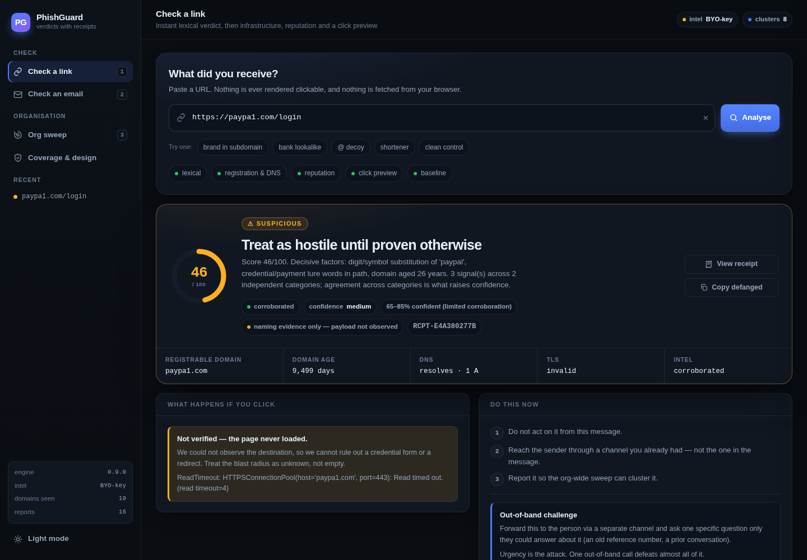

# PhishGuard

A phishing **link and email** checker that shows its work, protects the whole org from
one person's report, and covers the India-specific scams global tools miss.

It is a working application, not a mockup: **40 passing tests**, live RDAP/DNS/TLS
lookups, real DKIM verification, real BEC and bank-fraud detection.

```bash
./run.sh                           # macOS/Linux
run.bat                            # Windows (double-click)
# → http://localhost:8000
```

New to this? **See [RUN-LOCAL.md](RUN-LOCAL.md)** — laptop setup, troubleshooting table, and
what to check before pointing it at real mail.

---

## UI

A public-first product landing page, then a signed-in workspace with persistent
navigation, evidence-first verdicts, a receipt drawer, dark + light themes, and a
mobile layout that holds up at 390 px. The workspace sidebar can be hidden when it
isn't needed.



**Structure**
- **Public landing page** — explains link checks, email forensics, reputation keys,
  safe-preview behavior, evidence receipts, and current limitations before sign-in.
- **Workspace sidebar** — routes (Overview / Saved scans / Check a link / Check an email /
  Campaigns), recent checks persisted in `localStorage`, and a hide/show control.
- **Verdict hero** — score gauge, plain-language headline, confidence as a *range*,
  two honesty chips (`naming evidence only — payload not observed`, `degraded — lexical
  only`), and a facts strip (domain, age, DNS, TLS, intel).
- **Progressive rendering** — skeleton → instant lexical verdict → full corroboration,
  with a five-stage pipeline that lights up as each stage completes.
- **Evidence chain** — severity rail per signal, weight + category metadata, filter
  chips (all / critical / high / medium / low), and the teach-in-the-moment line.
- **Email view** — auth pills (SPF/DKIM/DMARC/ARC colour-coded, `none` ≠ `fail`),
  identity diff that flags Reply-To and Return-Path mismatches, links table with
  per-link *Deep scan*, attachment flags, payment identifiers with the trusted-baseline
  note, and Report → sweep.
- **Receipt drawer** — the audit JSON in a scrollable, copyable sheet.
- **Org sweep** — four KPI tiles (₹ value protected is the first one), campaign cluster
  cards with reports/clicked counts.

**Interaction**
- `/` or `⌘K` focuses the URL field · `1` `2` `3` jump between views · `Esc` closes the drawer.
- Drag-and-drop `.eml`, or paste raw source.
- Sample buttons for instant evaluation, no typing.
- Toasts for every async outcome; nothing fails silently.

**Design tokens** live at the top of `static/style.css` (`--danger`, `--warn`, `--ok`,
surfaces, radii, shadows) with a full `[data-theme="light"]` override — change the accent
in one place and the whole app follows. No external fonts, CSS or JS: the app renders
identically inside a sandboxed preview iframe and offline.

**Accessibility**
- Semantic `nav`/`main`/`aside`, `aria-current` on the active route, `aria-pressed` on
  toggles, `aria-live` on both result regions, labelled icon-only buttons, visible
  `:focus-visible` rings, and a `prefers-reduced-motion` kill switch.
- Colour is never the only carrier: every severity also has a text badge.

---

## What makes it different (and why that's sensible)

| Differentiator | Why it matters | Where it lives |
|---|---|---|
| **Compromised-sender / bank-change detection** | The dominant loss vector is a *real* account sending a *real* invoice with changed account details. Globally clean reputation, zero blocklist hits — blocklist tools cannot see it by design. | `store.check_vendor_account`, `emailscan._extract_accounts` |
| **Trusted-baseline rule** | A bank value taken from an unverified message never becomes the baseline. Otherwise one fraudulent invoice poisons the reference and the *second* attempt looks clean — exactly how double-invoicing fraud wins. | `store.py` |
| **Pre-click "blast radius"** | Not "is it bad" but "here's what happens if you click": login form, where the password POSTs, redirect chain. A demonstrated consequence beats a red icon. | `net.fetch_page`, `urlscan._preview_signals` |
| **Server-side preview, SSRF-guarded** | The user's browser never touches the hostile host. Private/loopback/metadata targets are refused, JS is never executed, nothing is submitted. | `net.is_public_host` |
| **Report-to-sweep** | One report clusters the campaign and warns everyone else who got it: *"5 reports, 1 click"*. Social proof is the most persuasive signal a human can be shown. | `store.add_report`, `/api/report` |
| **Time-of-click re-check** | Links are clean at delivery and hostile by lunchtime. Every URL is fingerprinted; if it flips from clean to bad, that is itself a signal. | `store.check_url_snapshot` |
| **First-contact / org baseline** | Scores against *your* normal instead of a global feed — the structural fix for the false-positive problem that gets tools switched off. | `store.observe_domain/sender` |
| **A real "Unknown"** | If infrastructure can't corroborate, the answer is "unverified", not a green tick. A shortener we can't expand is `unknown` by construction. | `verdict.judge(force_unknown=…)` |
| **Verdict receipts** | Every verdict exports the exact signals, weights and thresholds that produced it. Defensible in an incident review, not just a red light. | `verdict.build_receipt`, `/api/receipt/<id>` |
| **India-first corpus** | UPI collect-request fraud, KYC-expiry, electricity-disconnection, digital arrest, fake courier/customs, part-time task scams, loan apps, fake govt schemes, IRCTC, IFSC/VPA abuse. | `data.INDIA_RULES` |
| **Teach-in-the-moment** | Every signal carries the transferable lesson, so the checker trains people on real attacks they actually received. | `data.TEACH`, `verdict._tips` |
| **Progressive verdicts** | Lexical answer in ~5 ms, corroboration streams in. A slow checker gets bypassed. | `/api/check/url?mode=quick` then `mode=full` |
| **Never clickable** | Every URL is defanged (`hxxps://evil[.]com`). | `lexical.defang` |
| **BYO-key, privacy-first reputation** | Google Safe Browsing v5, VirusTotal, URLhaus, and PhishTank are optional signals. URL sharing is opt-in per full scan; unavailable/no-match providers never clear a URL as safe. | `intel.py`, `urlscan.py` |

---

## Architecture

```
app.py                  Flask routes: /api/check/url, /api/check/email, /api/report,
                        /api/clusters, /api/receipt/<id>, /api/vendor/confirm, /api/sample/<n>
engine/
  data.py               knowledge base: 180+ brands, legit-domain allowlist, TLD abuse,
                        homoglyphs, BEC lexicon, India scam corpus, teach-lines
  lexical.py            no-network URL analysis (the fast half of every verdict)
  net.py                SSRF-guarded fetch, RDAP domain age, DNS, TLS, HTML parsing
  intel.py              Safe Browsing v5, VirusTotal, URLhaus, PhishTank (optional keys)
  mailer.py             optional low-volume Gmail SMTP delivery for OTPs and notices
  push.py               optional VAPID Web Push delivery
  urlscan.py            orchestration: lexical → infrastructure → consented reputation → preview
  emailscan.py          SPF/DKIM/DMARC, Received-chain, BEC, India rules, attachments
  verdict.py            scoring, confidence, the honest "unknown", receipts
  store.py              SQLite/Postgres: baselines, auth, OTPs, subscriptions, clusters
templates/index.html    single-page UI (vanilla JS, no build step)
static/style.css
samples/*.eml           4 demo messages (3 attacks, 1 clean control)
tests/test_engine.py    40 tests, dominated by false-positive assertions
scripts/seed_demo.py    seeds vendor baselines + report clusters
```

### Verdict model

1. Every signal = `{id, severity, weight, evidence, category, tip}`.
2. Score = weighted sum with **positional decay** (1.0, 0.75, 0.6, …) so one critical
   signal is not diluted by ten weak ones, and ten weak ones can't add up to "malicious".
3. Tier: `≥65 malicious · ≥30 suspicious · ≥12 low · else safe`.
4. Two independent categories agreeing → confidence rises. No infrastructure data →
   confidence is `low` and the label becomes `unknown` rather than a clearance.
5. Everything is written to an audit receipt.

---

## What it does on real inputs

| Input | Verdict | Score |
|---|---|---|
| `paypal.com.secure-login-verify.top/account/verify` | malicious — brand in subdomain, high-abuse TLD | 76 |
| `hdfcbank.com.secure-verify.top/kyc` | malicious — brand in subdomain + lure path | 66 |
| `paypa1.com/login` | suspicious→malicious — digit substitution | 48 |
| `microsoft.com@evil-login.ru` | brand in userinfo decoy → critical | 42 |
| `inv…pdf.exe` | critical — double extension | 42 |
| `javascript:…` / `data:…` | critical — dangerous scheme | 40 |
| `bit.ly/…` (unexpandable) | **unknown**, not safe | 37 |
| `google.com`, `sbi.co.in`, `icicibank.com`, `incometax.gov.in`, `amazonaws.com` | likely safe | 0–2 |
| BEC sample: DMARC fail + Reply-To swap + bank change + `.docm` | malicious, high confidence | 100 |
| India UPI/KYC sample | malicious, high confidence | 94 |
| Digital-arrest sample | malicious, high confidence | 100 |
| Clean internal mail | likely safe | 0 |

---

## Steps to run it

### Secure account login

The dashboard has separate Create account and Log in screens. New accounts save a
unique username, an optional Gmail address, a normalized Indian mobile number, and
a one-way password hash. During signup, the user also chooses a password recovery
question and answer. The answer is normalized and stored only as a one-way hash.
Passwords are never saved as plain text. Successful login creates an HttpOnly,
SameSite session cookie. Failed logins are rate-limited for 15 minutes.

The login screen includes **Forgot password?**. A user enters their username,
answers the saved recovery question, and chooses a new password. Recovery answers
are rate-limited, the new password signs out older sessions, and the user is then
signed in on the current device. This is a convenient local recovery method, not
proof of Gmail or mobile ownership; for production deployment, use verified email
or mobile recovery as an additional factor. Existing accounts without a recovery
question can add one from Settings → Privacy & authentication after confirming
their current password.

Copy `.env.example` to `.env`. Keep `AUTH_COOKIE_SECURE=0` for local HTTP use and
set it to `1` when serving through HTTPS. Mobile numbers are format-validated only;
phone ownership is not verified because this version intentionally has no OTP.

The top-right profile menu shows the active username and mobile number, opens
settings, and provides Add account and Log out actions. The **Privacy &
authentication** section can add/change the Gmail address, mobile number, or
password. Every sensitive change requires the current password; changing the
password signs out other sessions. Multiple accounts can be
remembered on one browser by username only; switching accounts logs out the
current session and requires the selected account's password.

Settings opens with a choice-first hub: **Profile**, **Security**, **Notifications**,
**Privacy & data**, **Appearance**, and **Device & accounts**. Selecting a category
shows only its relevant controls. Security actions are progressive: choose an
account-security group, then choose a specific action such as updating Gmail or
mobile, changing a password, managing a recovery question, or reviewing login
activity. Privacy & data includes export, clearing personal activity, and
password-confirmed account deletion. Clearing personal data keeps the account and
security login history; deleting the account removes the account and its personal
activity permanently. Browser notifications can be enabled for completed scans, with optional sound.
Foreground notifications work while the app is open; optional VAPID Web Push can
also deliver scan alerts and weekly aggregate cluster notices when the site is closed.

The public landing page is shown before sign-in. The signed-in **Overview** page
shows recent checks on this device, saved scans, items flagged for review, and
clear next actions—there is no speculative account or website security score.
Link and email verdicts can be saved into named folders from the **Saved scans**
library. Saved scans are kept per username in that browser's local storage;
passwords and session tokens are never stored there.

The visual system uses warm evergreen, sage, and brass accents instead of a blue
palette. Dark and light themes remain available from the theme toggle.

Gmail is format-checked and stored as an account detail; this local version does
not send an email verification code. Existing accounts are upgraded automatically
with no Gmail address, and can add one later from Profile → Settings.

Profile settings also support customizable display name and initials, notification
preferences, last password-change information, recent login history with browser,
operating system and IP address, personal JSON data export, and password-confirmed
account deletion. Profile and authentication fields are migrated automatically for
existing databases.

### Help guide

The dashboard includes a small offline Help Guide. It answers predefined questions
about account creation, login, switching accounts, changing passwords or mobile
numbers, settings, link analysis, email analysis, saved data, and common startup problems. It uses no AI or web-search API,
so no API key is needed. The rest of PhishGuard can still use an internet connection
for full URL checks when requested.

### 1. Local (2 minutes)
```bash
cd phishguard
python3 -m venv .venv && source .venv/bin/activate
pip install -r requirements.txt
python3 scripts/seed_demo.py --reset     # demo vendor baseline + report clusters
python3 app.py                           # or ./run.sh
```
Open <http://localhost:8000>, then:
- **Check a link** → paste `http://paypal.com.secure-login-verify.top/account/verify`
- **Check an email** → *load sample: BEC bank-change* → note the critical
  "Bank details CHANGED vs this vendor's previous invoice"
- **Org sweep** → see value protected + campaign clusters

### 2. Optional reputation keys

Set provider keys only in server-side environment variables (`.env` locally or the
Vercel project settings). The local PhishGuard engines remain primary. The optional
Google Safe Browsing v5, VirusTotal, URLhaus, and PhishTank checks are additional
signals; unavailable providers and no-match responses do not establish safety.
Full scans ask for explicit per-scan consent before sending a URL to whichever
providers have been configured. Quick scans never make those calls. Review each
provider's non-commercial terms, rate limits, and data-retention rules before use.

```bash
cp .env.example .env
# Set only the keys for providers you choose to enable:
GSB_API_KEY=
VT_API_KEY=
URLHAUS_AUTH_KEY=
PHISHTANK_APP_KEY=
```

Missing keys are normal: the rest of PhishGuard continues to work without them.

### 3. Optional email and background push

These connections are off until their server-side variables are set. Gmail SMTP
works without a custom domain: use a Gmail sender with 2-Step Verification and a
Google App Password (never the account's normal password). In the app, users must
verify their own Gmail address and explicitly opt in before scan summaries or the
weekly aggregate cluster digest is delivered. Scan-summary delivery is capped at five emails per account per day and 100
notifications total per day; OTP code requests have a separate 100-per-day cap plus
per-address/IP throttling. Gmail's own limits and
terms still apply; this is intended for non-commercial, low-volume use.

```text
GMAIL_SMTP_USERNAME=your-sender@gmail.com
GMAIL_SMTP_APP_PASSWORD=<Google App Password>
GMAIL_FROM_ADDRESS=your-sender@gmail.com
GMAIL_SMTP_HOST=smtp.gmail.com
GMAIL_SMTP_PORT=587
CRON_SECRET=<long random value for the weekly Vercel cron>
PUBLIC_APP_URL=https://phisguard-five.vercel.app/
```

For background browser notifications, generate one VAPID key pair and configure
`VAPID_PUBLIC_KEY`, `VAPID_PRIVATE_KEY`, and `VAPID_SUBJECT` (for example,
`mailto:your-sender@gmail.com`). With project dependencies installed, this prints
a matching base64url key pair locally:

```bash
python - <<'PY'
from cryptography.hazmat.primitives import serialization
from py_vapid import Vapid
from py_vapid.utils import b64urlencode
v = Vapid()
v.generate_keys()
private = v.private_key.private_numbers().private_value.to_bytes(32, "big")
public = v.public_key.public_bytes(serialization.Encoding.X962,
    serialization.PublicFormat.UncompressedPoint)
print("VAPID_PRIVATE_KEY=" + b64urlencode(private))
print("VAPID_PUBLIC_KEY=" + b64urlencode(public))
PY
```

Treat the private key output as a secret and set it only server-side. Users subscribe
per browser; disabling browser notifications removes that device's subscription.
No paid push vendor is required. The weekly cron runs once a week; on Vercel Hobby,
keep scheduled jobs within the plan's daily schedule limit.


### 4. Deploy with Docker (the recommended way to keep a stable link)

Docker gives you a **host port**, so the URL is always `http://localhost:8000` — the
token-secured preview link from the hosted sandbox does not apply inside a container.

```bash
cd phishguard

# build once (~40s, deps are layer-cached)
docker build -t phishguard:0.9.0 .

# run it
docker run -d --name phishguard \
  -p 8000:8000 \
  -v phishguard-data:/app/data \
  --restart unless-stopped \
  phishguard:0.9.0

# open
#   → http://localhost:8000
```

Check it came up cleanly:

```bash
docker logs -f phishguard          # entrypoint seeds the DB, then gunicorn access log
docker ps --filter name=phishguard # wait for STATUS: healthy
curl -s localhost:8000/api/health  # {"ok":true,...}
```

**With docker compose** (handles the volume, healthcheck and env for you):

```bash
docker compose up -d --build
docker compose logs -f
docker compose down          # add -v to also delete the persisted data
```

**Optional reputation keys:**

```bash
docker run -d --name phishguard -p 8000:8000 -v phishguard-data:/app/data \
  -e GSB_API_KEY=your-key -e VT_API_KEY=your-key \
  -e URLHAUS_AUTH_KEY=your-key -e PHISHTANK_APP_KEY=your-key \
  phishguard:0.9.0
```

or put them in a `.env` next to `docker-compose.yml` and use `docker compose up -d`.

#### What the container does on start (`docker-entrypoint.sh`)

1. Ensures `/app/data` is writable by the unprivileged user (uid `10001`). If a
   host bind-mount is root-owned it falls back to `/tmp` **and says so loudly**,
   rather than dying with sqlite's “unable to open database file”.
2. Seeds demo baselines/clusters only when no database exists yet, so restarts keep
   your real data.
3. Prints whether reputation keys were detected (`BYO-key` mode is fully functional).
4. `exec`s gunicorn (2 workers × 8 threads) — no shell wrapper left holding PID 1.

#### Docker troubleshooting

| Symptom | Cause | Fix |
|---|---|---|
| `port is already allocated` | something already on 8000 | `-p 8080:8000`, then open `localhost:8080` |
| Page loads, banner says *falling back to /tmp* | root-owned bind mount | `mkdir -p ./data && sudo chown -R 10001:10001 ./data`, then mount `-v "$PWD/data:/app/data"` |
| `unhealthy` but the page works | healthcheck hits `127.0.0.1` inside the container | confirm you didn't override `PORT` — if you did, pass the same value to the healthcheck |
| Lookups (domain age, DNS) are empty | container has no outbound network | check the daemon's DNS/proxy policy; the app degrades to lexical-only and labels it |
| `exec format error` on Apple silicon | image built for another arch | `docker build --platform linux/amd64 -t phishguard .` (or build natively on the Mac) |
| Data gone after `docker rm` | ran without the volume | always pass `-v phishguard-data:/app/data` |

**Not exposed to the internet.** The container binds `0.0.0.0` inside, but you only
publish it to your host. To share it on a LAN, publish to all interfaces
(`-p 0.0.0.0:8000:8000`) and reach it at `http://<your-ip>:8000` — and put an
authenticating reverse proxy in front of it first, because there is no login by design.


### 5. Make it yours
- Add brands to `engine/data.py → BRANDS` and, crucially, real ones to `LEGIT_DOMAINS`
  (the allowlist is what keeps false positives at zero).
- Add local scam patterns to `INDIA_RULES` — `{id, pattern, title, evidence, weight, tip}`.
  Then run the tests; `test_india_rules_have_all_fields` forces the documentation fields.
- Add a teach-line to `TEACH` for every new signal id you introduce.
- Wire `POST /api/report` from your mail gateway so reporting happens before anyone clicks.
- Feed `report.json` clusters into your SIEM/SOAR; `GET /api/receipt/<id>` is the artifact.

### 6. Before you trust it in production
- [ ] Replace the dev server with gunicorn/uWSGI (the Dockerfile already does).
- [ ] Put the preview fetcher in an isolated egress-only container or a real sandbox VM.
- [ ] Add auth, rate limiting and a per-tenant data-retention policy (emails are PII).
- [ ] Run an eval: PhishTank/OpenPhish/URLhaus for recall, **Tranco top-1M for false
      positives**. Report precision/recall at a fixed FPR ≤ 0.1%, not "99% accuracy".
- [ ] Add adversarial tests: cloaking (different page per User-Agent), redirect chains,
      delayed payloads, QR codes in images, `.msg` support.
- [ ] Decide retention: this build stores hashes and counts, plus full receipts — trim
      `receipts` on a schedule.

---

## Deliberate non-features

- **No opaque risk score.** Scores derive from named, weighted, auditable signals.
- **No JS execution or form submission** in the preview. It reads HTML and describes it.
- **No AI chat bubble.** An evidence chain with citations beats a paragraph of prose.
- **No silent green ticks.** Degraded mode is labelled every time.

## Known limits (stated, not hidden)

- `.eml` only; `.msg` needs one more parser.
- Images/QR codes are not decoded (attachment hashes are reported instead).
- The public-suffix list is deliberately small and India-heavy — swap in the full PSL for
  wider coverage.
- Preview is a single HTML GET; it will not catch JS-only or logged-in gating.
- SQLite is fine for a desk/team; move to Postgres for multi-tenant use.

## Deploy to Vercel

Vercel's serverless filesystem is temporary. Before deploying the app for real use,
connect a persistent Postgres database (for example, a free Neon database through
Vercel Marketplace) and set `DATABASE_URL` in the Vercel project environment. The
app keeps SQLite as its local-development default and uses Postgres when that
variable is present. If the database is not configured, the Vercel function returns
a setup-required response rather than storing account data in ephemeral storage.
